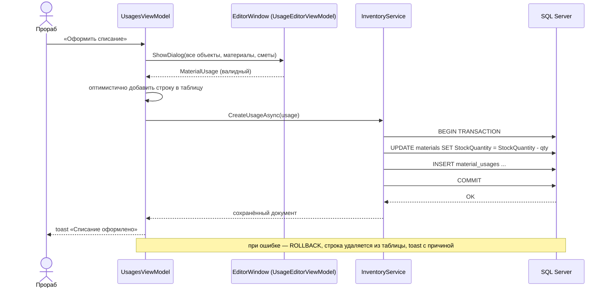

# Архитектура приложения «СтройКонтроль»

## 1. Общая схема

```
┌───────────────────────────────────────────────┐
│            WPF-клиент (StroyControl.App)      │
│  Views (XAML)  ←binding→  ViewModels (MVVM)    │
│        ↑                       ↓              │
│  Converters/Controls      Services:           │
│  Styles/Templates         DialogService,      │
│                           ToastService,       │
│                           ApplicationController│
└───────────────────────────┬───────────────────┘
                            │ интерфейсы Core
┌───────────────────────────▼───────────────────┐
│      Слой данных (StroyControl.Data)          │
│  EF Core DbContext, конфигурации, репозитории │
│  InventoryService, DeviationService,          │
│  DashboardService, DemoDataSeeder             │
└───────────────────────────┬───────────────────┘
                            │ SqlClient (TCP 1433)
                    ┌───────▼────────┐
                    │  SQL Server    │
                    │  (StroyControl)│
                    └────────────────┘
```

Три проекта разделяют ответственность:

| Проект | Ответственность | Зависимости |
|---|---|---|
| `StroyControl.Core` | доменные сущности, перечисления, DTO, интерфейсы, бизнес-правила (расчёт отклонений, хеширование паролей, экспорт CSV), сессия | нет (чистый .NET) |
| `StroyControl.Data` | EF Core, конфигурации сущностей, репозитории, транзакционные сервисы, наполнение БД | Core, EF Core, Microsoft.Data.SqlClient |
| `StroyControl.App` | WPF/MVVM: окна, страницы, модели представления, стили, конвертеры, диалоги | Core, Data, CommunityToolkit.Mvvm |

## 2. ER-модель


Все таблицы дополнительно содержат `RowVersion` (токен оптимистической блокировки), `CreatedAt`, `UpdatedAt`.

## 3. Ключевые классы

### Core

| Класс | Назначение |
|---|---|
| `EntityBase` | `Id`, `RowVersion`, `CreatedAt`, `UpdatedAt` |
| `DeviationCalculator` | чистые функции: классификация отклонения (5 % / 10 %), расчёт строки отчёта, средневзвешенная цена |
| `DeviationRow` / `DeviationReport` | строки и сводка отчёта об отклонениях |
| `DashboardData`, `ProjectBudgetRow`, `MonthlyCostRow`, `ActivityItem` | DTO панели управления |
| `PasswordHasher` | PBKDF2-HMAC-SHA256, 100 000 итераций, соль 16 байт |
| `AuthService` | проверка учётных данных, блокировка неактивных учётных записей |
| `UserService` | CRUD учётных записей, проверка уникальности логина, защита последнего администратора |
| `SessionService` | текущий пользователь и вычисляемые права (`CanEditMaterials`, `CanEditEstimates`, `CanEditDeliveries`, `CanViewFinance`, `CanExportReports`, `CanManageUsers`) |
| `CsvReportExporter` | отчёт об отклонениях в CSV (`;`, UTF-8 BOM — открывается в Excel) |

### Data

| Класс | Назначение |
|---|---|
| `AppDbContext` | `DbSet`'ы, `ApplyConfigurationsFromAssembly`, аудит и инкремент `RowVersion` |
| `IConfiguration`-классы в `Configurations/` | длины строк, точность decimal, индексы, FK и правила удаления |
| `RepositoryBase<T>` | CRUD на каждый вызов с новым `DbContext`; перевод `DbUpdateException` в `AppException` |
| `EstimateRepository` | сметы с позициями, отдельные операции над позициями |
| `InventoryService` | транзакционное проведение поступлений и списаний, пересчёт остатков |
| `DeviationService` | соединение плана (позиции смет) и факта (списания) с агрегацией по «объект + материал» |
| `DashboardService` | KPI, бюджеты объектов, дефицит, помесячные затраты, лента операций |
| `DatabaseHealthService` | `CanConnect`, количество пользователей и материалов |
| `DemoDataSeeder` | детерминированные демо-данные (фиксированное зерно) |

### App

| Группа | Классы |
|---|---|
| Окна | `LoginWindow`, `MainWindow`, `Dialogs/EditorWindow`, `Dialogs/ConfirmWindow` |
| Страницы | `DashboardView`, `MaterialsView`, `SuppliersView`, `ProjectsView`, `EstimatesView`, `DeliveriesView`, `UsagesView`, `DeviationsView`, `UsersView`, `SettingsView` |
| Модели представления | `MainViewModel`, `LoginViewModel`, `DashboardViewModel`, `MaterialsViewModel`, … , `SettingsViewModel` |
| Диалоги (VM) | `EditorViewModelBase` + 8 редакторов (`MaterialEditorViewModel`, `DeliveryEditorViewModel`, …) |
| Инфраструктура | `IToastService`, `IDialogService`, `ApplicationController`, `AppEnvironment`, `SqlServerProbe`, `PasswordBoxHelper` |
| UI-компоненты | `LoadingOverlay`, `EmptyState`, `KpiCard`, `ToastHost`, конвертеры |

## 4. Проведение документа (пример: поступление)

1. Пользователь заполняет диалог `DeliveryEditorViewModel` (строки с материалами, количество, цена).
2. `Validate()` проверяет номер, поставщика и хотя бы одну корректную строку.
3. Страница `DeliveriesViewModel` вызывает `IInventoryService.UpdateDeliveryAsync` / `CreateDeliveryAsync`.
4. `InventoryService` открывает транзакцию, загружает материалы, изменяет `StockQuantity`, сохраняет документ.
5. При `DbUpdateException`/`DbUpdateConcurrencyException` транзакция откатывается, наружу летит `AppException` с понятным текстом.
6. Страница убирает оптимистично добавленную строку (или возвращает старую версию) и показывает toast с ошибкой.

## 5. Алгоритм анализа отклонений

```
1. Загрузить сметы (с позициями и материалами), отфильтровать по объекту.
2. Загрузить списания, просуммировать количество и стоимость по (ProjectId, MaterialId).
3. Сгруппировать позиции смет по (ProjectId, MaterialId):
     PlannedQuantity = Σ PlannedQuantity
     PlannedCost     = Σ (PlannedQuantity × PlannedUnitPrice)
     PlannedPrice    = PlannedCost / PlannedQuantity
4. Для каждой группы собрать DeviationRow (факт отсутствует → нули).
5. Отсортировать по |Δ стоимости|, посчитать сводку: план, факт, Δ, Δ %, количество критичных.
```

Преимущества выбранной агрегации: материал, встречающийся в нескольких сметах одного объекта, не учитывается дважды, а итог отчёта совпадает с суммой фактических затрат по объекту.

## 6. Матрица прав

| Действие | Флаг `SessionService` | Admin | Engineer | SupplyManager | Foreman | Accountant |
|---|---|:--:|:--:|:--:|:--:|:--:|
| Просмотр справочников, смет и документов | — | ✔ | ✔ | ✔ | ✔ | ✔ |
| Справочник материалов (номенклатура, цены) | `CanEditMaterials` | ✔ | ✔ | — | — | — |
| Справочник поставщиков | `CanEditSuppliers` | ✔ | ✔ | ✔ | — | — |
| Справочник объектов | `CanEditProjects` | ✔ | ✔ | — | — | — |
| Сметы и позиции смет (план) | `CanEditEstimates` | ✔ | ✔ | — | — | — |
| Поступления материалов | `CanEditDeliveries` | ✔ | ✔ | ✔ | ✔ | — |
| Списания материалов (факт) | `CanEditUsages` | ✔ | ✔ | — | ✔ | — |
| Финансы, смета и отклонения (просмотр) | `CanViewFinance` | ✔ | ✔ | ✔ | ✔ | ✔ |
| Формирование и экспорт отчётов | `CanExportReports` | ✔ | ✔ | — | — | ✔ |
| Управление сотрудниками | `CanManageUsers` | ✔ | — | — | — | — |

Логика разделения: **смету (план) меняет только ИТО и администратор**, прораб работает исключительно с фактом (поступления и списания), снабженец — с поставщиками и поступлениями, но видит бюджет по смете, бухгалтер не редактирует документы, а формирует отчётность.

Права вычисляются в `SessionService` по отдельным флагам (единого `CanEdit` больше нет — у каждой страницы своё право) и используются в моделях представления (`CanEdit` на странице = соответствующий флаг сессии) и в разметке (`IsEnabled`). Матрица закреплена тестами `SessionServiceTests` в `tests/StroyControl.Core.Tests`.

## 7. Обработка ошибок и состояний UI

- **Загрузка** — `IsBusy` в `ViewModelBase`, оверлей `LoadingOverlay` с анимированным индикатором.
- **Пустые состояния** — два варианта: «данных ещё нет» (с призывом создать) и «ничего не найдено» (сброс фильтров).
- **Оптимистичные обновления** — коллекция меняется до ответа БД, при ошибке выполняется откат и toast.
- **Ошибки БД** — репозитории и сервисы транслируют технические исключения в `AppException` с пользовательским текстом.
- **Конкурентный доступ** — `RowVersion` + сообщение «Запись уже изменена другим пользователем».
- **Необработанные исключения** — `DispatcherUnhandledException` показывает диалог и не «роняет» приложение.

## 8. Диаграмма последовательности: списание материала



## 9. Проектные диаграммы

Полный комплект диаграмм вынесен в отдельный каталог [docs/diagrams](diagrams/README.md): исходники в Mermaid (отрисовываются прямо на GitHub) и готовые изображения 300 dpi. Сводный документ для пояснительной записки — [docs/Диаграммы.docx](Диаграммы.docx) (подписи по ГОСТ: «Рисунок N — …»).

| № | Диаграмма | Файл |
|---|---|---|
| 1 | Варианты использования (5 акторов, «include»/«extend») | [01-use-case.md](diagrams/01-use-case.md) |
| 2 | Анализа: границы, управления, сущности | [02-analysis-classes.md](diagrams/02-analysis-classes.md) |
| 3 | Последовательности: вход в систему | [03-sequence-login.md](diagrams/03-sequence-login.md) |
| 4 | Деятельности: оформление списания | [04-activity-usage.md](diagrams/04-activity-usage.md) |
| 5 | Деятельности: «Работа со сметой» | [05-activity-estimate.md](diagrams/05-activity-estimate.md) |
| 6 | Автоматов: навигация по разделам | [06-state-navigation.md](diagrams/06-state-navigation.md) |

Изображения и документ пересобираются скриптом `tools/render_diagrams.py` (Python + Pillow + python-docx).

## 10. Отчёт по смете

Отчёт «Расчёт количества и стоимости работ и материалов» строится классом `EstimateReportBuilder` (`StroyControl.Core/Dtos/EstimateReport.cs`) — чистая функция без обращения к БД, поэтому покрыта модульными тестами (`EstimateReportBuilderTests`).

**Позиции сметы.** В одной смете хранятся и материалы, и работы: у позиции есть `IsWork`, для работы заполняются `WorkName` и `WorkUnit`, для материала — `MaterialId` (теперь допускает `NULL`). Раздел задаётся полем `Section`.

**Формулы (округление до копеек, `MidpointRounding.AwayFromZero`):**

| Показатель | Формула |
|---|---|
| Цена с наценкой | `PlannedUnitPrice × (1 + MarkupPercent / 100)` |
| Итого по позиции | `PlannedQuantity × Цена с наценкой` |
| Прибыль позиции | `Итого × ProfitPercent / 100` |
| Зарплата рабочих | только для работ: `Итого × LaborSharePercent / 100` |
| Прямые затраты | материалы + работы |
| Всего затрат | прямые затраты + прибыль |
| Стоимость 1 м² | `Всего затрат / Project.TotalArea` |
| Прибыль от 1 м² | `Прибыль / Project.TotalArea` |

Коэффициенты хранятся в смете (`MarkupPercent`, `ProfitPercent`, `LaborSharePercent`, по умолчанию 10 / 12 / 35 %) и могут быть изменены прямо в окне отчёта без записи в БД — это сценарий «что если».

**Представление.** `EstimateReportDocument` собирает `FlowDocument` (Times New Roman, А4): шапка с итогами, таблица с разделами, подгруппами «Работы» / «Материалы», подытогами и итогом по смете. Тот же документ уходит в печать, поэтому экран и бумага совпадают. Экспорт `EstimateReportExporter` формирует CSV (UTF-8 BOM, `;`) и полноценный `.xlsx` — книга OOXML собирается вручную через `System.IO.Compression` без сторонних библиотек (стили, объединённые ячейки шапки, формат `#,##0.00`, закреплённая строка заголовка).

## 11. Диаграммы на панели управления

Три элемента рисуют себя сами (`Controls/BarChart`, `DonutChart`, `LineChart` — наследники `ChartBase`, переопределяют `OnRender`), внешних библиотек нет:

- **План и факт по объектам** — сгруппированные столбики, красный цвет при перерасходе;
- **Структура затрат** — кольцевая диаграмма по `Material.Category` (топ-5 + «Прочие»), подпись итога в центре;
  блок «сумма + BYN» центрируется по обеим осям относительно центра кольца, а кегль автоматически
  уменьшается, если сумма шире внутреннего отверстия (толщина кольца — 0,36 радиуса);
- **Динамика по месяцам** — две линии (план пунктиром, факт сплошной) и точки.

Данные агрегирует `DashboardService` (`ProjectBudgets`, `CategoryCosts`, `MonthlyCosts`), диаграммы получают готовые DTO. Цвета берутся из ресурсов темы, при переключении темы контролы перерисовываются по событию `ThemeManager.ThemeChanged`.

## 12. Темы оформления и контекстные меню

Обе палитры выдержаны в фиолетовой гамме: светлая — серо-лиловый холст `#F5F4F9`, белые карточки, сливовая навигация `#1F1730` и фиолетовый акцент `#7C3AED`; тёмная — почти чёрный лиловый холст `#131019` с графитовыми поверхностями и светлым фиолетовым акцентом `#A78BFA`. Основные действия (`.PrimaryButton`) окрашены акцентом, карточки — радиус 10, кнопки — радиус 6; палитра диаграмм также начинается с фиолетового (`#7C3AED`, `#22B8CF`, `#2FA36B`, `#F0A020`, `#3B82F6`, `#E4637C`).

Все `DataGrid` в приложении обязаны подключать `Style="{StaticResource DataGridStyle}"`: без него WPF берёт системный шаблон строки с белым фоном (`RowBackground`), и в тёмной теме строка редактора выглядела светлой полосой. В самом стиле `RowBackground` и `AlternatingRowBackground` теперь явно прозрачные — фон даёт родительская карточка.

`DatePicker` получил собственный шаблон: поле даты (`DatePickerTextBox`) больше не рисуется системным белым прямоугольником с чёрным текстом, а календарь (`Calendar`, `CalendarDayButton`, `CalendarButton`) использует кисти темы. Стили `TextBlock` и корня окна задают `Foreground` через `DynamicResource`, поэтому в тёмной теме текст остаётся светлым.

Палитра вынесена в два словаря с одинаковым набором ключей: `Resources/Theme/Palette.Light.xaml` и `Palette.Dark.xaml`. Стили ссылаются на кисти через `DynamicResource`, поэтому `ThemeManager.Apply` просто подменяет словарь в `Application.Resources.MergedDictionaries` — без перезапуска окна. Выбор темы сохраняется в `%APPDATA%\StroyControl\ui.json` и применяется в `App.StartAsync` до показа окна входа.

Компоновка: в боковом меню остались восемь рабочих разделов, а «Сотрудники» (только администратор) и «Настройки» переехали в верхнюю панель — рядом с переключателем темы, кнопкой обновления и профилем.

Неявный стиль `TextBlock` в `Controls.xaml` задаёт `Foreground="{DynamicResource TextPrimaryBrush}"`: без него
текст без явного цвета наследовал системный чёрный и в тёмной теме сливался с фоном. Там же `Foreground` получили
стили `DatePicker` и корень `MainWindow`; печатный отчёт (`EstimateReportDocument`) сознательно остаётся чёрным
на белом.

**Фильтры по объекту.** `ComboBox` с привязкой `SelectedProjectFilter` в режиме `TwoWay` при `Options.Clear()`
записывает в модель `null`, после чего предикат `== AllProjects` не пропускал ни одной строки. Поэтому в
`EstimatesViewModel`, `UsagesViewModel`, `DeliveriesViewModel` выбранное значение сохраняется перед перезагрузкой
списка и восстанавливается после (с откатом на «Все объекты»), аналогично восстанавливается категория в
`MaterialsViewModel`; `null` и пустая строка трактуются как «Все объекты».

Контекстное меню добавлено ко всем таблицам (`DataGrid.ContextMenu`). Команды не дублируются: пункты привязываются к тем же `Edit/Delete/Add/Refresh/ExportCommand` модели представления через `PlacementTarget.DataContext`, а `IsEnabled` — к правам роли (`CanEdit`, `CanManage`, `CanExport`). «Копировать» использует `ApplicationCommands.Copy`, то есть штатное копирование ячеек DataGrid.

## 13. Транзакции и стратегия выполнения EF Core

Провайдер SQL Server настроен с `EnableRetryOnFailure` (`StroyControl.Data/ServiceCollectionExtensions.cs`), поэтому EF использует `SqlServerRetryingExecutionStrategy`. Такая стратегия **запрещает** открывать транзакцию вручную (`Database.BeginTransactionAsync`) вне `ExecuteAsync` — операция должна повторяться целиком.

Поэтому `InventoryService` работает через общий помощник:

```csharp
await using var probe = await _factory.CreateDbContextAsync(ct);
var strategy = probe.Database.CreateExecutionStrategy();

return await strategy.ExecuteAsync(async () =>
{
    await using var db = await _factory.CreateDbContextAsync(ct);   // новый контекст на каждую попытку
    var transaction = await BeginTransactionAsync(db, ct);
    try { return await body(db, transaction, ct); }
    finally { if (transaction is not null) await transaction.DisposeAsync(); }
});
```

Публичные методы (`CreateDeliveryAsync`, `UpdateDeliveryAsync`, `DeleteDeliveryAsync`, `CreateUsageAsync`, `UpdateUsageAsync`, `DeleteUsageAsync`) — тонкие обёртки, вся работа с данными вынесена в `...CoreAsync(db, transaction, ...)`. Контекст создаётся заново на каждую попытку, поэтому повтор не тащит за собой уже отслеживаемые сущности (иначе остатки изменились бы дважды). Для демо-режима (InMemory) транзакция не открывается (`IsRelational() == false`).

## 14. Товарный чек

`Views/Reports/PurchaseReceiptDocument` собирает `FlowDocument` формата A5: заголовок с номером и датой, реквизиты продавца (наименование, УНП, адрес, телефон) и покупателя (организация из `AppEnvironment.Organization` + объект или «общий склад»), основание (накладная и ТТН), таблица позиций с итогом, сумма к оплате и подписи. Тот же документ показывается в `PurchaseReceiptWindow` (предпросмотр) и печатается — печать в PDF выполняется через принтер «Microsoft Print to PDF», как и в отчёте по смете.

Точки входа: пункт «Товарный чек» в контекстном меню и кнопка в панели «Поступлений» (`PrintReceiptCommand`), а также автоматический показ чека после сохранения закупки по дефициту — накладная перечитывается через `IDeliveryRepository.GetWithItemsAsync`, чтобы в документ попали наименования материалов, поставщик и объект.

## 15. Закупка по дефициту

`PurchasePlanner` (`src/StroyControl.Core/Dtos/PurchasePlanner.cs`) — чистая логика без БД, покрыта тестами
`tests/StroyControl.Core.Tests/PurchasePlannerTests.cs`:

- `Deficit(materials, limit)` — активные материалы с `StockQuantity ≤ MinStock`, сортировка по нехватке,
  затем по наименованию;
- `SuggestedQuantity(material)` — `MinStock × TargetFactor − StockQuantity` (`TargetFactor = 2`), не меньше 1,
  округление до тысячных `AwayFromZero`;
- `SuggestedCost(material)` — количество × учётная цена.

Точки входа: команда `PurchaseDeficitCommand` в `MaterialsViewModel` (кнопка «Закупить дефицит») и в
`DashboardViewModel` (кнопка в карточке «Требуют закупки»). Обе проверяют `Session.CanEditDeliveries`, вызывают
`IDialogService.EditDelivery(null, suppliers, projects, materials, deficit)` — редактор накладной получает
необязательный список `suggested` и заполняет `Items` строками `DeliveryItemDraft`, подставляя поставщика
первого материала, — а затем сохраняют документ через `IInventoryService.CreateDeliveryAsync`, то есть тем же
транзакционным путём, что и обычное поступление.

## 16. Миграция схемы при обновлении

Схема создаётся `EnsureCreated`, который не изменяет существующую базу, поэтому добавленные поля догоняются идемпотентными командами:

- `StroyControl.Data/Seed/SchemaPatcher` — выполняется при старте приложения;
- `database/schema.sql`, раздел 10.1 — те же `ALTER TABLE ... IF COL_LENGTH(...) IS NULL` для ручного развёртывания.

Добавленные поля: `estimate_items.IsWork`, `WorkName`, `WorkUnit` (и `MaterialId` стал `NULL`-допустимым), `estimates.MarkupPercent`, `ProfitPercent`, `LaborSharePercent`, `projects.TotalArea`.
