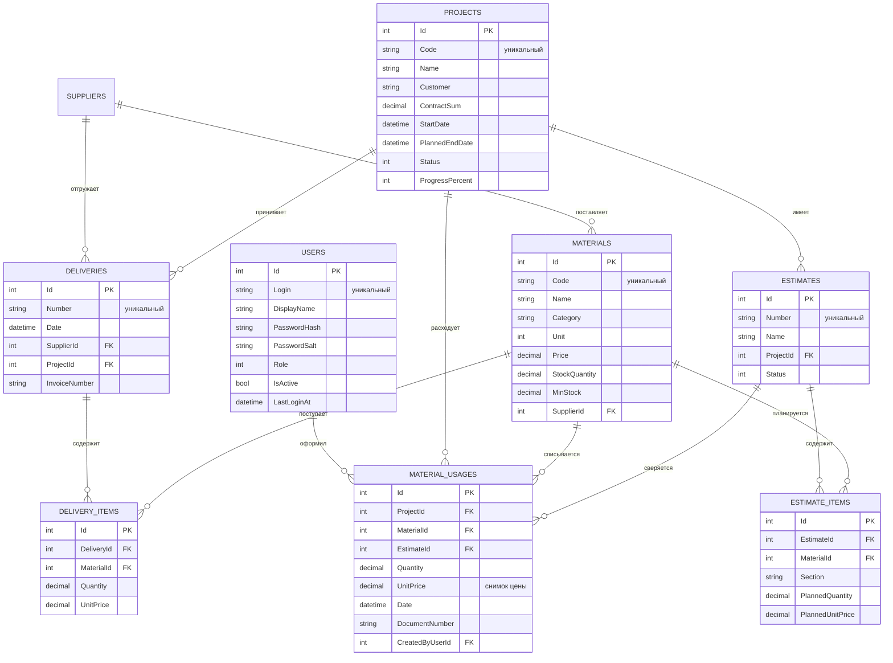
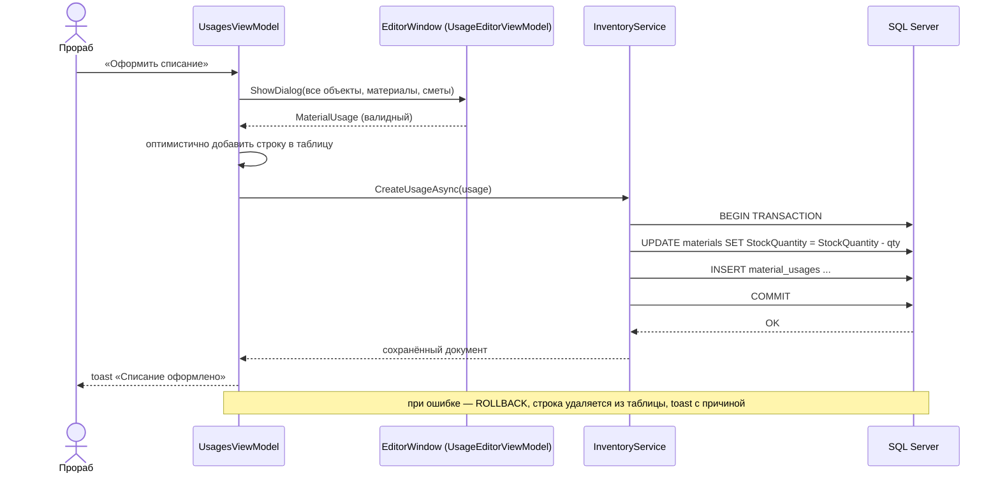

# Архитектура приложения «СтройКонтроль»

## 1. Общая схема

```
┌───────────────────────────────────────────────┐
│            WPF-клиент (StroyControl.App)      │
│  Views (XAML)  ←binding→  ViewModels (MVVM)    │
│        ↑                       ↓              │
│  Converters/Controls      Services:           │
│  Styles/Templates         DialogService,      │
│                           ToastService,       │
│                           ApplicationController│
└───────────────────────────┬───────────────────┘
                            │ интерфейсы Core
┌───────────────────────────▼───────────────────┐
│      Слой данных (StroyControl.Data)          │
│  EF Core DbContext, конфигурации, репозитории │
│  InventoryService, DeviationService,          │
│  DashboardService, DemoDataSeeder             │
└───────────────────────────┬───────────────────┘
                            │ SqlClient (TCP 1433)
                    ┌───────▼────────┐
                    │  SQL Server    │
                    │  (StroyControl)│
                    └────────────────┘
```

Три проекта разделяют ответственность:

| Проект | Ответственность | Зависимости |
|---|---|---|
| `StroyControl.Core` | доменные сущности, перечисления, DTO, интерфейсы, бизнес-правила (расчёт отклонений, хеширование паролей, экспорт CSV), сессия | нет (чистый .NET) |
| `StroyControl.Data` | EF Core, конфигурации сущностей, репозитории, транзакционные сервисы, наполнение БД | Core, EF Core, Microsoft.Data.SqlClient |
| `StroyControl.App` | WPF/MVVM: окна, страницы, модели представления, стили, конвертеры, диалоги | Core, Data, CommunityToolkit.Mvvm |

## 2. ER-модель



Все таблицы дополнительно содержат `RowVersion` (токен оптимистической блокировки), `CreatedAt`, `UpdatedAt`.

## 3. Ключевые классы

### Core

| Класс | Назначение |
|---|---|
| `EntityBase` | `Id`, `RowVersion`, `CreatedAt`, `UpdatedAt` |
| `DeviationCalculator` | чистые функции: классификация отклонения (5 % / 10 %), расчёт строки отчёта, средневзвешенная цена |
| `DeviationRow` / `DeviationReport` | строки и сводка отчёта об отклонениях |
| `DashboardData`, `ProjectBudgetRow`, `MonthlyCostRow`, `ActivityItem` | DTO панели управления |
| `PasswordHasher` | PBKDF2-HMAC-SHA256, 100 000 итераций, соль 16 байт |
| `AuthService` | проверка учётных данных, блокировка неактивных учётных записей |
| `UserService` | CRUD учётных записей, проверка уникальности логина, защита последнего администратора |
| `SessionService` | текущий пользователь и вычисляемые права (`CanEditMaterials`, `CanEditEstimates`, `CanEditDeliveries`, `CanViewFinance`, `CanExportReports`, `CanManageUsers`) |
| `CsvReportExporter` | отчёт об отклонениях в CSV (`;`, UTF-8 BOM — открывается в Excel) |

### Data

| Класс | Назначение |
|---|---|
| `AppDbContext` | `DbSet`'ы, `ApplyConfigurationsFromAssembly`, аудит и инкремент `RowVersion` |
| `IConfiguration`-классы в `Configurations/` | длины строк, точность decimal, индексы, FK и правила удаления |
| `RepositoryBase<T>` | CRUD на каждый вызов с новым `DbContext`; перевод `DbUpdateException` в `AppException` |
| `EstimateRepository` | сметы с позициями, отдельные операции над позициями |
| `InventoryService` | транзакционное проведение поступлений и списаний, пересчёт остатков |
| `DeviationService` | соединение плана (позиции смет) и факта (списания) с агрегацией по «объект + материал» |
| `DashboardService` | KPI, бюджеты объектов, дефицит, помесячные затраты, лента операций |
| `DatabaseHealthService` | `CanConnect`, количество пользователей и материалов |
| `DemoDataSeeder` | детерминированные демо-данные (фиксированное зерно) |

### App

| Группа | Классы |
|---|---|
| Окна | `LoginWindow`, `MainWindow`, `Dialogs/EditorWindow`, `Dialogs/ConfirmWindow` |
| Страницы | `DashboardView`, `MaterialsView`, `SuppliersView`, `ProjectsView`, `EstimatesView`, `DeliveriesView`, `UsagesView`, `DeviationsView`, `UsersView`, `SettingsView` |
| Модели представления | `MainViewModel`, `LoginViewModel`, `DashboardViewModel`, `MaterialsViewModel`, … , `SettingsViewModel` |
| Диалоги (VM) | `EditorViewModelBase` + 8 редакторов (`MaterialEditorViewModel`, `DeliveryEditorViewModel`, …) |
| Инфраструктура | `IToastService`, `IDialogService`, `ApplicationController`, `AppEnvironment`, `SqlServerProbe`, `PasswordBoxHelper` |
| UI-компоненты | `LoadingOverlay`, `EmptyState`, `KpiCard`, `ToastHost`, конвертеры |

## 4. Проведение документа (пример: поступление)

1. Пользователь заполняет диалог `DeliveryEditorViewModel` (строки с материалами, количество, цена).
2. `Validate()` проверяет номер, поставщика и хотя бы одну корректную строку.
3. Страница `DeliveriesViewModel` вызывает `IInventoryService.UpdateDeliveryAsync` / `CreateDeliveryAsync`.
4. `InventoryService` открывает транзакцию, загружает материалы, изменяет `StockQuantity`, сохраняет документ.
5. При `DbUpdateException`/`DbUpdateConcurrencyException` транзакция откатывается, наружу летит `AppException` с понятным текстом.
6. Страница убирает оптимистично добавленную строку (или возвращает старую версию) и показывает toast с ошибкой.

## 5. Алгоритм анализа отклонений

```
1. Загрузить сметы (с позициями и материалами), отфильтровать по объекту.
2. Загрузить списания, просуммировать количество и стоимость по (ProjectId, MaterialId).
3. Сгруппировать позиции смет по (ProjectId, MaterialId):
     PlannedQuantity = Σ PlannedQuantity
     PlannedCost     = Σ (PlannedQuantity × PlannedUnitPrice)
     PlannedPrice    = PlannedCost / PlannedQuantity
4. Для каждой группы собрать DeviationRow (факт отсутствует → нули).
5. Отсортировать по |Δ стоимости|, посчитать сводку: план, факт, Δ, Δ %, количество критичных.
```

Преимущества выбранной агрегации: материал, встречающийся в нескольких сметах одного объекта, не учитывается дважды, а итог отчёта совпадает с суммой фактических затрат по объекту.

## 6. Матрица прав

| Действие | Флаг `SessionService` | Admin | Engineer | SupplyManager | Foreman | Accountant |
|---|---|:--:|:--:|:--:|:--:|:--:|
| Просмотр справочников, смет и документов | — | ✔ | ✔ | ✔ | ✔ | ✔ |
| Справочник материалов (номенклатура, цены) | `CanEditMaterials` | ✔ | ✔ | — | — | — |
| Справочник поставщиков | `CanEditSuppliers` | ✔ | ✔ | ✔ | — | — |
| Справочник объектов | `CanEditProjects` | ✔ | ✔ | — | — | — |
| Сметы и позиции смет (план) | `CanEditEstimates` | ✔ | ✔ | — | — | — |
| Поступления материалов | `CanEditDeliveries` | ✔ | ✔ | ✔ | ✔ | — |
| Списания материалов (факт) | `CanEditUsages` | ✔ | ✔ | — | ✔ | — |
| Финансы, смета и отклонения (просмотр) | `CanViewFinance` | ✔ | ✔ | ✔ | ✔ | ✔ |
| Формирование и экспорт отчётов | `CanExportReports` | ✔ | ✔ | — | — | ✔ |
| Управление сотрудниками | `CanManageUsers` | ✔ | — | — | — | — |

Логика разделения: **смету (план) меняет только ИТО и администратор**, прораб работает исключительно с фактом (поступления и списания), снабженец — с поставщиками и поступлениями, но видит бюджет по смете, бухгалтер не редактирует документы, а формирует отчётность.

Права вычисляются в `SessionService` по отдельным флагам (единого `CanEdit` больше нет — у каждой страницы своё право) и используются в моделях представления (`CanEdit` на странице = соответствующий флаг сессии) и в разметке (`IsEnabled`). Матрица закреплена тестами `SessionServiceTests` в `tests/StroyControl.Core.Tests`.

## 7. Обработка ошибок и состояний UI

- **Загрузка** — `IsBusy` в `ViewModelBase`, оверлей `LoadingOverlay` с анимированным индикатором.
- **Пустые состояния** — два варианта: «данных ещё нет» (с призывом создать) и «ничего не найдено» (сброс фильтров).
- **Оптимистичные обновления** — коллекция меняется до ответа БД, при ошибке выполняется откат и toast.
- **Ошибки БД** — репозитории и сервисы транслируют технические исключения в `AppException` с пользовательским текстом.
- **Конкурентный доступ** — `RowVersion` + сообщение «Запись уже изменена другим пользователем».
- **Необработанные исключения** — `DispatcherUnhandledException` показывает диалог и не «роняет» приложение.

## 8. Диаграмма последовательности: списание материала


