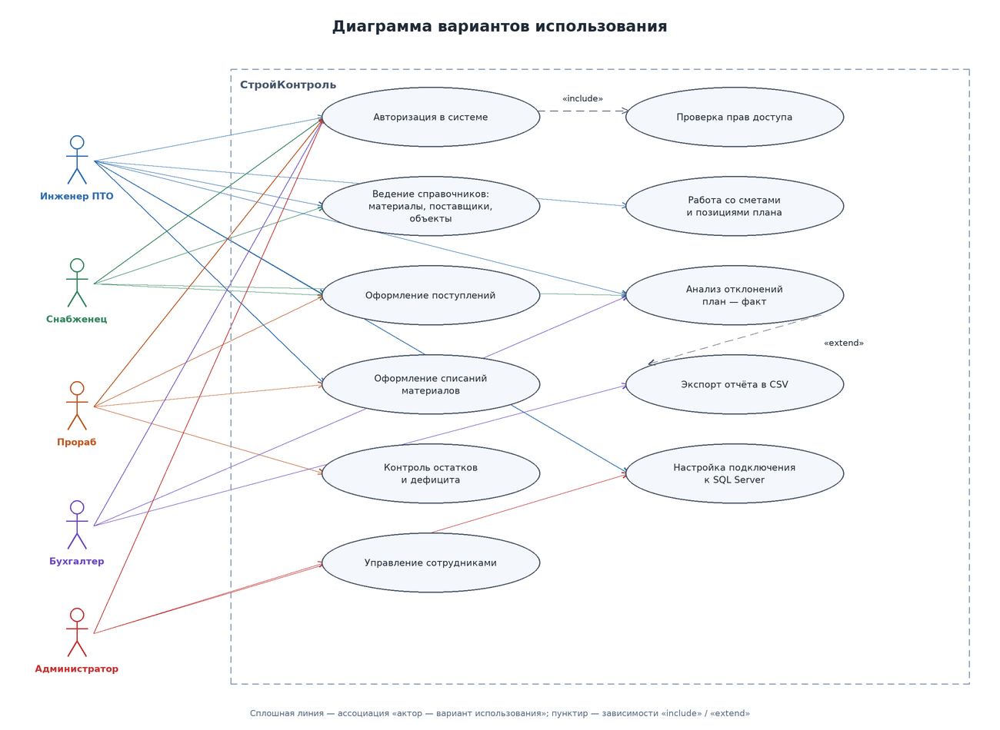
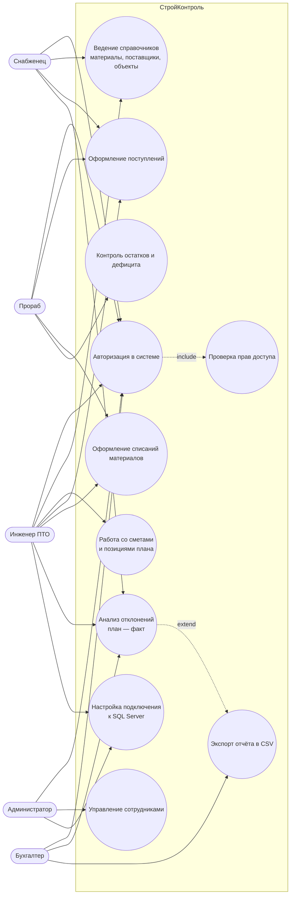

# Диаграмма вариантов использования

Пять акторов соответствуют пяти ролям системы. Общими для всех являются авторизация и проверка прав доступа; редактирование смет доступно только инженеру ПТО и администратору, прораб работает с поступлениями и списаниями, бухгалтер — только просмотр и экспорт отчётов.
