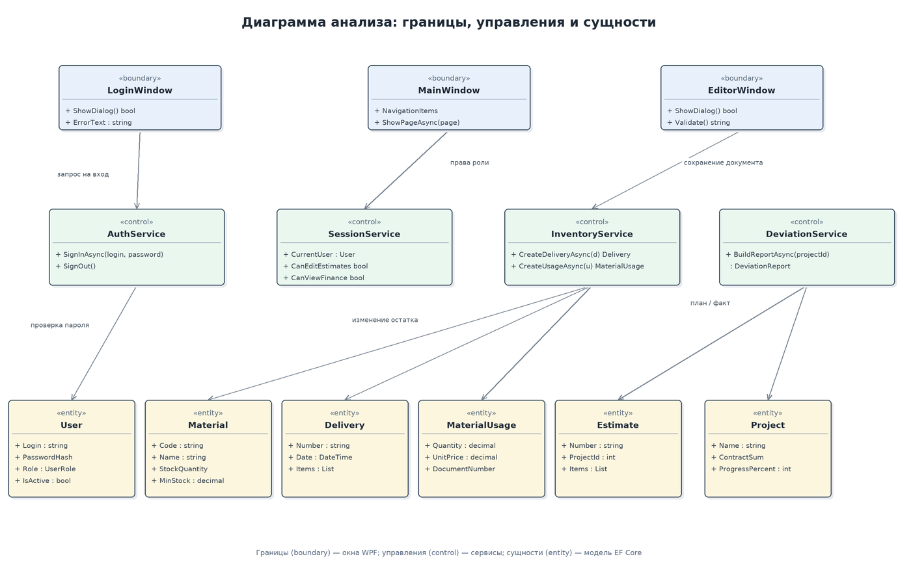
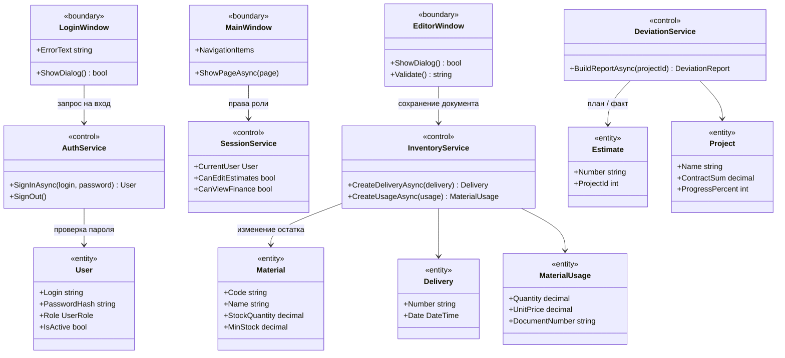

# Диаграмма анализа: границы, управления и сущности

Границы — окна WPF (`LoginWindow`, `MainWindow`, `EditorWindow`), управления — сервисы слоя данных и ядра, сущности — классы модели EF Core, отображаемые в таблицы SQL Server.
