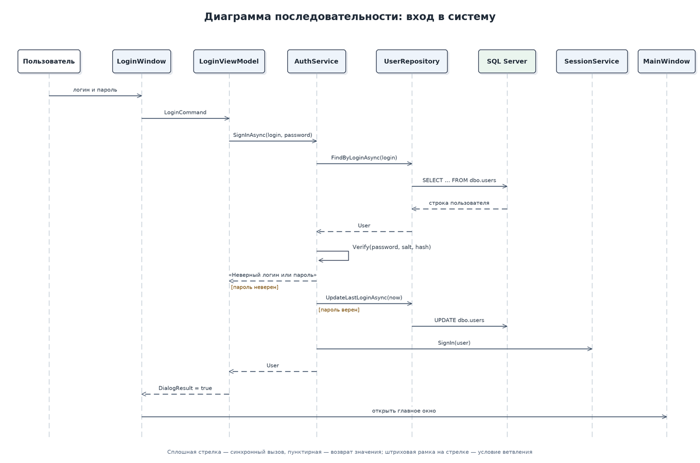
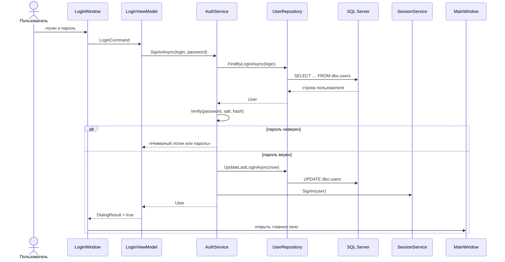

# Диаграмма последовательности: вход в систему

Пароль не передаётся и не хранится в открытом виде: `AuthService` получает из базы хеш и соль, а проверка выполняется по схеме PBKDF2-HMAC-SHA256 (100 000 итераций). После успешного входа `SessionService` сохраняет пользователя и вычисляет права роли.
