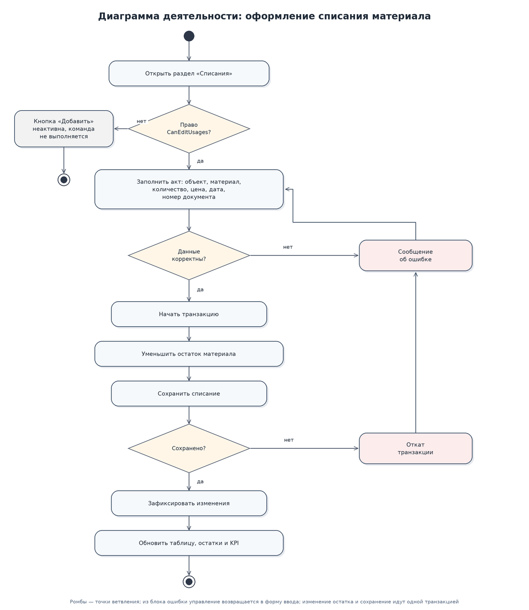
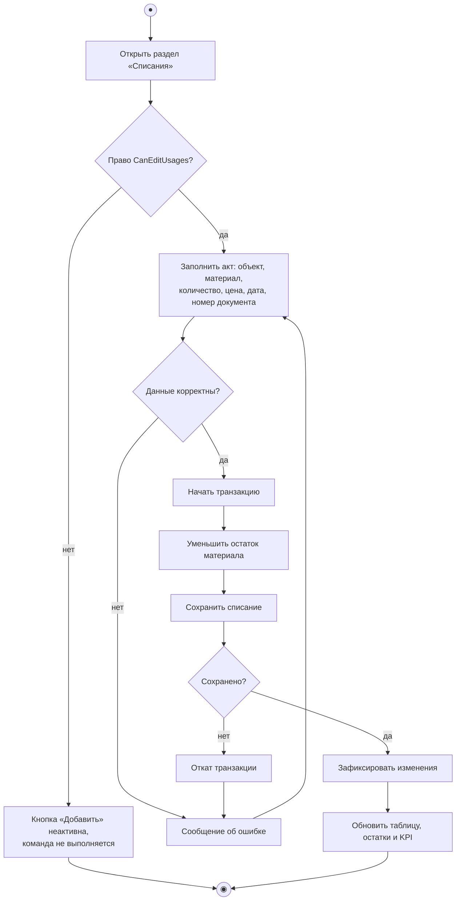

# Диаграмма деятельности: оформление списания материала

Ключевой момент: списание и изменение остатка материала выполняются в одной транзакции, поэтому при сбое сохранения остаток не «уедет» и данные останутся согласованными.
