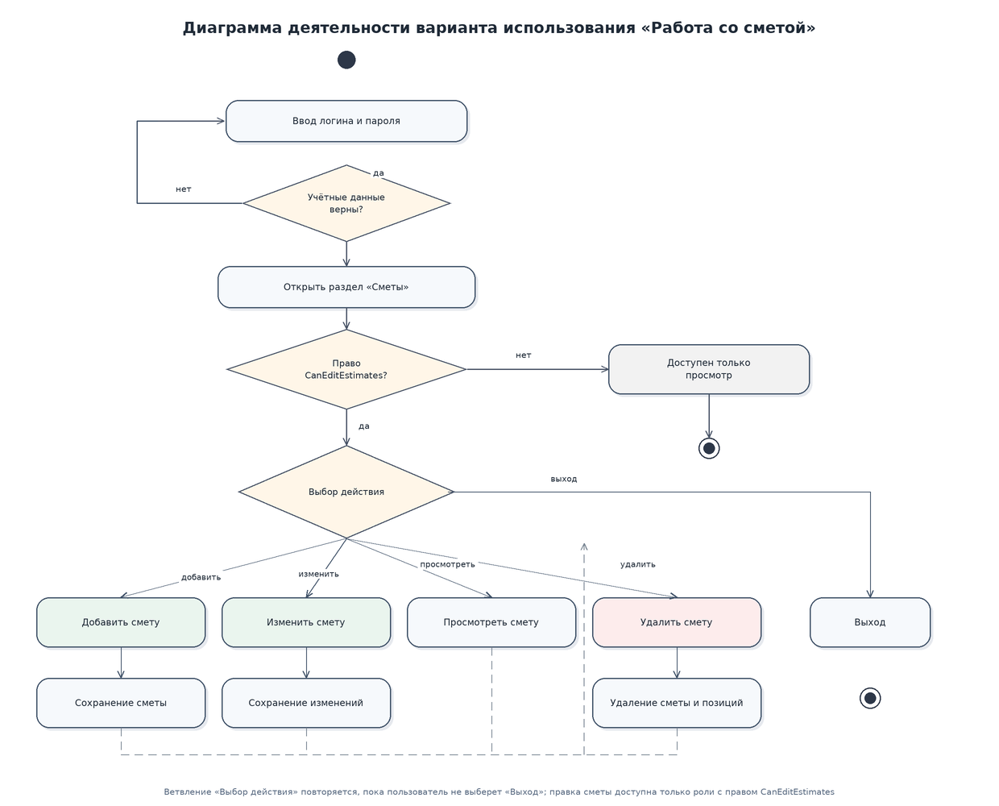
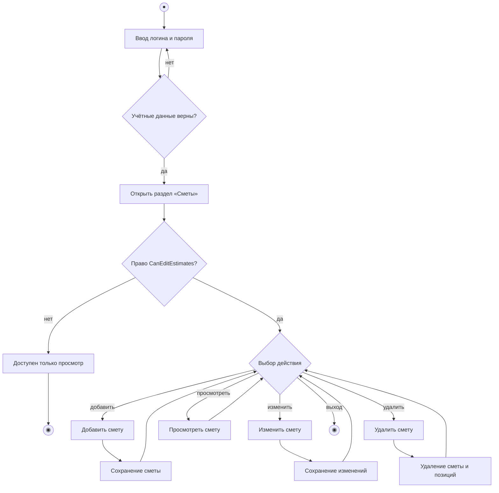

# Диаграмма деятельности варианта использования «Работа со сметой»

Сценарий повторяется в цикле, пока пользователь не выберет «Выход». Ветвление по праву `CanEditEstimates` отделяет инженера ПТО (может изменять смету) от остальных ролей, которым доступен только просмотр.
