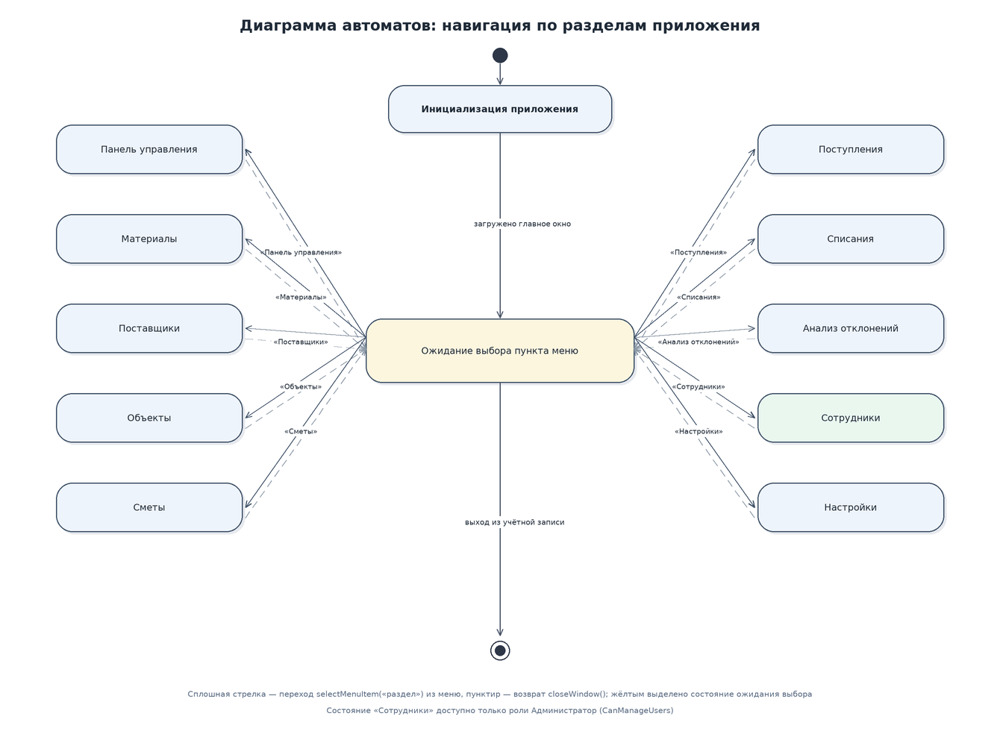

# Диаграмма автоматов: навигация по разделам приложения

```mermaid
stateDiagram-v2
    [*] --> Init
    state "Инициализация приложения" as Init
    state "Ожидание выбора пункта меню" as Menu
    state "Панель управления" as Dashboard
    state "Материалы" as Materials
    state "Поставщики" as Suppliers
    state "Объекты" as Projects
    state "Сметы" as Estimates
    state "Поступления" as Deliveries
    state "Списания" as Usages
    state "Анализ отклонений" as Deviations
    state "Сотрудники (только Admin)" as Users
    state "Настройки" as Settings

    Init --> Menu : загружено главное окно
    Menu --> Dashboard : selectMenuItem("Панель управления")
    Menu --> Materials : selectMenuItem("Материалы")
    Menu --> Suppliers : selectMenuItem("Поставщики")
    Menu --> Projects : selectMenuItem("Объекты")
    Menu --> Estimates : selectMenuItem("Сметы")
    Menu --> Deliveries : selectMenuItem("Поступления")
    Menu --> Usages : selectMenuItem("Списания")
    Menu --> Deviations : selectMenuItem("Анализ отклонений")
    Menu --> Users : selectMenuItem("Сотрудники")
    Menu --> Settings : selectMenuItem("Настройки")

    Dashboard --> Menu : closeWindow()
    Materials --> Menu : closeWindow()
    Suppliers --> Menu : closeWindow()
    Projects --> Menu : closeWindow()
    Estimates --> Menu : closeWindow()
    Deliveries --> Menu : closeWindow()
    Usages --> Menu : closeWindow()
    Deviations --> Menu : closeWindow()
    Users --> Menu : closeWindow()
    Settings --> Menu : closeWindow()

    Menu --> [*] : выход из учётной записи
```

Автомат описывает поведение главного окна: из состояния ожидания выбора пользователь переходит в один из десяти разделов и возвращается обратно. Состояние «Сотрудники» доступно только роли с правом `CanManageUsers`, то есть администратору.
